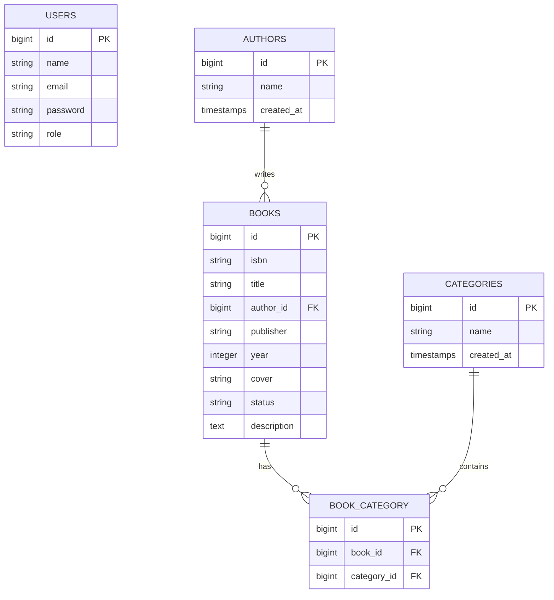
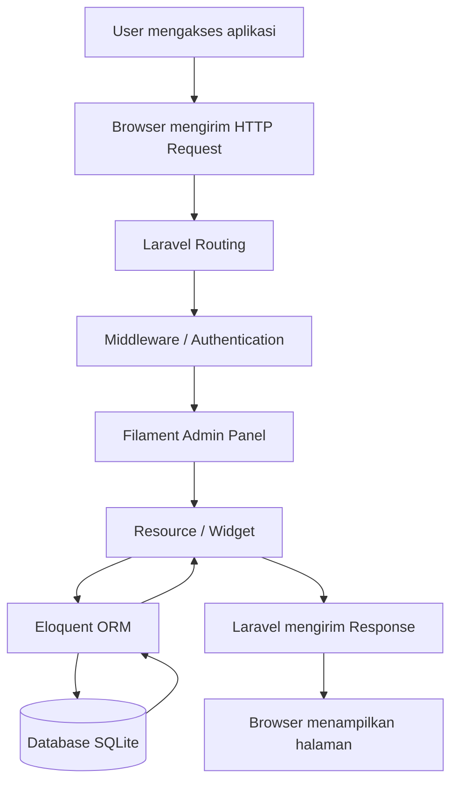

<div align="center">

# PRAK-PBW-A-CHANDRA-24-22

# "PRAKTIKUM PBW – A"

*"Disusun Untuk Memenuhi Tugas Mata Kuliah Praktikum PBW A"*

<br>
<br>  <br>
<br>

**Disusun Oleh**

Chandra Cornelius L Tobing - 4524210022

**Dosen Pengampu**

Bambang Riono Arsad, S.Kom., MMSI

<br>

### PROGRAM STUDI TEKNIK INFORMATIKA
### UNIVERSITAS PANCASILA
### 2026-2027

</div>

---

## Daftar Isi

- [Pertemuan 1 dan 2](#pertemuan-1-dan-2-tugas-1-dan-2)
  - [Cara Install](#cara-install)
  - [1. Menjalankan Ulang Contoh Pertemuan 1](#1-menjalankan-ulang-contoh-pertemuan-1)
  - [2. Penjelasan Bagian Kode yang Paling Penting](#2-penjelasan-bagian-kode-yang-paling-penting)
  - [3. Ringkasan Hasil Program](#3-ringkasan-hasil-program)
  - [4. Error yang Pernah Muncul](#4-error-yang-pernah-muncul)
- [Pertemuan 3](#pertemuan-3)
  - [1. Cara Install Laravel](#1-cara-install-laravel)
  - [2. Tugas yang Dikerjakan](#2-tugas-yang-dikerjakan)
  - [3. Fitur-Fitur Utama](#3-fitur-fitur-utama)
  - [4. Halaman yang Dihasilkan](#4-halaman-yang-dihasilkan)
- [Pertemuan 4](#pertemuan-4)
  - [1. Cara Install](#1-cara-install)
  - [2. Tugas yang Dikerjakan](#2-tugas-yang-dikerjakan-1)
  - [3. Fitur-Fitur Utama](#3-fitur-fitur-utama-1)
  - [4. Halaman yang Dihasilkan](#4-halaman-yang-dihasilkan-1)
- [Pertemuan 5](#pertemuan-5)
  - [1. Cara Install](#1-cara-install-1)
  - [2. Tugas yang Dikerjakan](#2-tugas-yang-dikerjakan-2)
  - [3. Fitur-Fitur Utama](#3-fitur-fitur-utama-2)
  - [4. Halaman yang Dihasilkan](#4-halaman-yang-dihasilkan-2)
- [Pertemuan 6](#pertemuan-6)
  - [6.1 Cara Install dan Menjalankan](#61-cara-install-dan-menjalankan)
  - [6.2 Tugas 1: Implementasi Dasar](#62-tugas-1-implementasi-dasar)
  - [6.3 Tugas 2: Kustomisasi dan Pengembangan](#63-tugas-2-kustomisasi-dan-pengembangan)
  - [6.4 Tugas 3: Analisis dan Dokumentasi](#64-tugas-3-analisis-dan-dokumentasi)
- [📂 Panduan Git & GitHub](./panduan/README.md)

---

# Pertemuan 1 dan 2 (Tugas 1 dan 2)

Materi: dasar PHP, client-server, dan HTTP method (GET dan POST), dengan dua contoh program (`kalkulator.php` dan `biodata.php`).

Ketentuan Tugas 1:

1. Menjalankan seluruh contoh Pertemuan 1 hingga menghasilkan output tanpa error kritis.
2. Menjelaskan lima bagian kode yang paling penting dari program.
3. Merangkum hasil program yang dijalankan.
4. Menuliskan satu error yang pernah muncul, penyebabnya, dan langkah perbaikannya.

Program dikerjakan pada folder [`Prak1`](Prak1):

| File | Keterangan |
| --- | --- |
| `kalkulator.php` | Program kalkulator |
| `biodata.php` | Program biodata mahasiswa |

## Cara Install

### Kebutuhan

| Kebutuhan | Keterangan |
| --- | --- |
| PHP | Versi 8.2 ke atas |
| Web server dan database | Apache dan MySQL/MariaDB (lewat XAMPP atau Laragon) |
| Composer | Dependency manager untuk PHP |
| Code editor | Visual Studio Code |

### 1. Install XAMPP / Laragon

### 1.1 Install Laragon

1. Unduh installer Laragon melalui [Website Resmi Laragon](https://laragon.org/download/).
2. Jalankan installer dan ikuti proses instalasi. Disarankan menggunakan lokasi `C:/laragon`.
3. Setelah instalasi selesai, buka Laragon.
4. Klik **Start All** untuk menjalankan Apache dan MySQL.
5. Buka terminal Laragon melalui menu **Terminal**.
6. Ketik perintah berikut untuk memeriksa versi PHP:

   ```bash
   php -v
   ```

7. Jika informasi versi PHP muncul, berarti PHP sudah berhasil terpasang dan terbaca.

**Catatan:**
- Laragon umumnya sudah mengatur environment PHP secara otomatis melalui terminal bawaannya.
- Jika ingin menggunakan PHP melalui CMD atau PowerShell Windows, pastikan direktori PHP Laragon sudah ditambahkan ke Environment Variables pada bagian `Path`.
- Contoh lokasi PHP: `C:\laragon\bin\php\php-8.x.x`.

### 1.2. Install XAMPP

1. Unduh installer XAMPP melalui [Website Resmi Apache Friends](https://www.apachefriends.org/).
2. Jalankan installer dan ikuti proses instalasi. Disarankan menggunakan lokasi `C:/xampp`.
3. Setelah instalasi selesai, buka **XAMPP Control Panel**.
4. Klik **Start** pada Apache dan MySQL jika diperlukan.
5. Buka terminal/CMD dan ketik perintah berikut:

   ```bash
   php -v
   ```

6. Jika versi PHP belum muncul, PHP perlu ditambahkan ke Environment Variables Windows.
7. Buka pencarian Windows, ketik `env`, kemudian pilih **Edit the system environment variables**.
8. Klik **Environment Variables**.
9. Pada bagian **System Variables** atau **User Variables**, pilih `Path`, lalu klik **Edit**.
10. Klik **New**, kemudian tambahkan direktori PHP XAMPP:

    ```text
    C:\xampp\php
    ```

11. Klik **OK** sampai semua jendela tertutup.
12. Tutup dan buka kembali CMD atau terminal, lalu periksa:

    ```bash
    php -v
    ```

13. Jika informasi versi PHP muncul, berarti PHP berhasil dikonfigurasi.

**Catatan:**
- Direktori `C:\xampp\mysql\bin` tidak perlu ditambahkan untuk menjalankan perintah PHP.
- Jika ingin menggunakan perintah MySQL melalui CMD, direktori tersebut dapat ditambahkan secara terpisah ke `Path`.

### 2. Install Composer

1. Unduh installer Composer, lalu pasang di laptop.
2. Saat diminta lokasi `php.exe`, arahkan ke `C:\xampp\php\php.exe`.
3. Lanjutkan dengan **Next** sampai instalasi selesai.
4. Buka terminal baru, lalu ketik `composer -V` untuk memastikan Composer terpasang.

### 3. Ambil Project dari GitHub

```bash
git clone https://github.com/chandracornelius13/PRAK-PBW-A-CHANDRA-24-22.git
```

Simpan folder hasil clone di folder root web server:

| Aplikasi | Lokasi folder |
| --- | --- |
| Laragon | `C:\laragon\www\` |
| XAMPP | `C:\xampp\htdocs\` |

### 4. Jalankan Program

1. Jalankan **Apache** (Laragon: **Start All**, XAMPP: **Start** pada Apache).
2. Buka browser, lalu akses salah satu alamat berikut.

| Program | Alamat |
| --- | --- |
| Kalkulator | `http://localhost/PRAK-PBW-A-CHANDRA-24-22/Prak1/kalkulator.php` |
| Biodata | `http://localhost/PRAK-PBW-A-CHANDRA-24-22/Prak1/biodata.php` |

Program Pertemuan 1 hanya memakai PHP, sehingga tidak memerlukan `composer install` maupun database.

---

## 1. Menjalankan Ulang Contoh Pertemuan 1

Kedua program, `kalkulator.php` dan `biodata.php`, berhasil dijalankan tanpa error.

## 2. Penjelasan Bagian Kode yang Paling Penting

### 1. Pengambilan Data Formulir

Nilai yang dikirim melalui formulir HTML diterima oleh PHP menggunakan `$_GET` atau `$_POST`, tergantung metode yang dipakai pada form.

### 2. Variabel dan Pengolahan Input

Variabel menampung nilai yang diterima dari pengguna, seperti angka pada kalkulator atau data pada biodata, sehingga nilai tersebut dapat diproses pada langkah berikutnya.

### 3. Percabangan Kondisi

Percabangan seperti `if`, `elseif`, dan `else` menentukan proses yang dijalankan berdasarkan kondisi tertentu, misalnya memilih operasi pada kalkulator atau memeriksa input yang diberikan.

### 4. Proses Perhitungan atau Pengolahan Data

Bagian ini menjalankan logika utama program, yaitu operasi aritmetika pada kalkulator dan pengolahan data pada biodata.

### 5. Menampilkan Hasil ke Halaman

PHP mengirimkan hasil pengolahan ke halaman menggunakan output seperti `echo`, sehingga pengguna dapat langsung melihat hasilnya di browser.

## 3. Ringkasan Hasil Program

| Program | Hasil |
| --- | --- |
| Kalkulator | Menerima input angka dan operasi, lalu menampilkan hasil perhitungan di halaman. |
| Biodata | Menerima data mahasiswa melalui form, lalu menampilkan data tersebut di halaman. |

## 4. Error yang Pernah Muncul

**Pesan error:**

```
[tempel pesan error asli di sini]
```

**Penyebab:** [isi penyebab sesuai pesan error yang muncul]

**Perbaikan:** [isi langkah perbaikan yang dilakukan]

---

# Pertemuan 3

Materi: Instalasi, Konfigurasi, dan Halaman Pertama Laravel 12 (Arsitektur MVC, HTTP Request Lifecycle, Routing `routes/web.php`, dan Templating Blade `resources/views/`).

Proyek Utama: **LaraPress** (Aplikasi Blog Sederhana)

---

## 1. Cara Install Laravel

### Kebutuhan Sistem & Environment

| Perangkat / Software | Standar Versi | Fungsi Utama |
| --- | --- | --- |
| **PHP** | Minimal 8.2 | Programming language runtime |
| **Web Server & DB** | Laragon / XAMPP | Apache & MySQL |
| **Composer** | 2.x | Manajer dependensi PHP |
| **Terminal / CLI** | Terminal Laragon / CMD / Git Bash | Menjalankan Artisan & Composer |
| **Code Editor** | Visual Studio Code | Menulis kode |
| **Web Browser** | Chrome / Firefox / Brave | Menguji tampilan |

### Langkah-Langkah Instalasi Proyek LaraPress

1. **Buat proyek baru via Composer** (di `C:\laragon\www\` atau `C:\xampp\htdocs\`):
   ```bash
   composer create-project laravel/laravel:"^12.0" LaraPress
   ```

2. **Masuk ke direktori proyek:**
   ```bash
   cd LaraPress
   ```

3. **Konfigurasi environment dan application key:**
   ```bash
   copy .env.example .env
   php artisan key:generate
   ```

4. **Jalankan development server:**
   ```bash
   php artisan serve
   ```
   Aplikasi berjalan di `http://127.0.0.1:8000`

---

## 2. Tugas yang Dikerjakan

1. **Tugas Utama**:
   - Membangun proyek Laravel 12 bernama **LaraPress**.
   - Membuat rute `/` pada `routes/web.php` yang menampilkan `welcome.blade.php`.
   - Membuat rute `/tentang-kami` yang menampilkan `about.blade.php`.
   - Menghubungkan kedua halaman dengan link navigasi.

2. **Tugas Mandiri**:
   - Membuat halaman statis **Kontak** dengan rute `/kontak` dan view `contact.blade.php`.

Pada pertemuan ini, LaraPress digunakan untuk mempraktikkan routing dan Blade dengan tiga halaman: halaman utama, Tentang Kami, dan Kontak.

---

## 3. Fitur-Fitur Utama

* **Halaman Utama (`/`)**: Menampilkan halaman awal LaraPress melalui view `welcome.blade.php`.
* **Halaman Tentang Kami (`/tentang-kami`)**: Menampilkan informasi singkat mengenai LaraPress melalui view `about.blade.php`.
* **Halaman Kontak (`/kontak`)**: Menampilkan halaman kontak statis melalui view `contact.blade.php`.
* **Navigasi Bar & Footer**: Memudahkan pengguna berpindah antara halaman utama, Tentang Kami, dan Kontak.
* **Antarmuka**: Tampilan disusun dengan template Blade.

---

## 4. Halaman yang Dihasilkan

| Halaman | Rute | View |
| --- | --- | --- |
| Halaman Utama | `/` | `welcome.blade.php` |
| Tentang Kami | `/tentang-kami` | `about.blade.php` |
| Kontak | `/kontak` | `contact.blade.php` |

---

# Pertemuan 4

Materi: Autentikasi Login

Proyek Utama: **LaraPress**

---

## 1. Cara Install

### Kebutuhan Sistem & Environment

| Perangkat / Package | Standar Versi | Fungsi Utama |
| --- | --- | --- |
| **PHP** | Minimal 8.2 | Runtime |
| **Framework** | Laravel 12.x | Framework utama |
| **Starter Kit** | Laravel Breeze | Autentikasi |
| **Database** | MySQL / MariaDB | Tabel users & sessions |
| **Frontend Tooling** | Node.js & NPM | Asset bundler |

### Langkah-Langkah Instalasi Laravel Breeze

1. Masuk ke folder proyek:
   ```bash
   cd LaraPress
   ```
2. Install Breeze:
   ```bash
   composer require laravel/breeze --dev
   ```
3. Jalankan installer:
   ```bash
   php artisan breeze:install
   ```
   Pilihan yang dipakai: stack `Blade with Alpine`, dark mode `No`, dan testing `Pest`.
4. Install dependensi frontend:
   ```bash
   npm install
   npm run dev
   ```
5. Jalankan migrasi database:
   ```bash
   php artisan migrate
   ```
6. Jalankan server:
   ```bash
   php artisan serve
   ```

---

## 2. Tugas yang Dikerjakan

1. **Memahami konsep autentikasi**: perbedaan autentikasi dan otorisasi, password hashing (Bcrypt), proteksi CSRF, serta peran cookies dan session.
2. **Instalasi dan konfigurasi Laravel Breeze** pada LaraPress.
3. **Proteksi rute dengan middleware `auth`** untuk `/dashboard` dan `/profile`.
4. **Kustomisasi UI** halaman login, register, dashboard, dan profil agar sesuai dengan kebutuhan proyek.

---

## 3. Fitur-Fitur Utama

* 🔑 **Registrasi & Login**: Laravel Breeze menyediakan halaman registrasi dan login beserta proses autentikasinya.
* 🛡️ **Password Hashing & CSRF**: Password disimpan dalam bentuk hash, dan token CSRF melindungi formulir dari permintaan yang tidak sah.
* 🚧 **Proteksi Rute Middleware (`auth`)**: Rute yang membutuhkan login hanya bisa diakses oleh pengguna yang sudah terautentikasi.
* 👤 **Dashboard**: Halaman `/dashboard` dapat diakses setelah pengguna berhasil login.
* ⚙️ **Pengelolaan Profil**: Halaman `/profile` memungkinkan pengguna mengelola informasi akunnya sesuai fitur bawaan Breeze.

---

## 4. Halaman yang Dihasilkan

| Halaman | Rute | Akses |
| --- | --- | --- |
| Login | `/login` | Publik |
| Registrasi | `/register` | Publik |
| Dashboard | `/dashboard` | Harus login |
| Profil | `/profile` | Harus login |

---

# Pertemuan 5

Materi: Operasi **CRUD** pada Laravel, konfigurasi dinamis dengan caching, buku tamu digital, dan pengamanan rute dengan middleware autentikasi.

Proyek Utama: **SMP Mentari**

## 1. Cara Install

### Kebutuhan Sistem & Environment

| Perangkat / Package | Standar Versi | Fungsi Utama |
| --- | --- | --- |
| **PHP** | Minimal 8.2 | Runtime |
| **Framework** | Laravel 13.11.0 | Framework utama |
| **Starter Kit** | Laravel Breeze | Autentikasi admin |
| **Database** | MySQL / MariaDB | Penyimpanan data |
| **Frontend Tooling** | Node.js & NPM | Asset bundler |

### Langkah-Langkah Instalasi

1. Masuk ke folder proyek SMP Mentari:
   ```bash
   cd SMP-Mentari
   ```
2. Install dependensi frontend:
   ```bash
   npm install
   npm run dev
   ```
3. Jalankan migrasi database sesuai konfigurasi `.env`:
   ```bash
   php artisan migrate
   ```
4. Jalankan server:
   ```bash
   php artisan serve
   ```

---

## 2. Tugas yang Dikerjakan

1. **Skema database dan migrasi**: Menyiapkan struktur tabel melalui migration Laravel untuk menyimpan data aplikasi.
2. **Eloquent Model dan caching**: Menggunakan Eloquent Model untuk mengakses data, serta caching untuk konfigurasi atau data yang sering dibaca.
3. **Controller dan logika bisnis**: Mengatur alur pengolahan data dan logika aplikasi melalui controller.
4. **Routing terstruktur (`routes/web.php`)**: Mendefinisikan rute untuk halaman publik dan fitur pengelolaan.
5. **Kustomisasi antarmuka**: Menyusun tampilan halaman publik dan halaman admin SMP Mentari.

---

## 3. Fitur-Fitur Utama

### A. Fitur Halaman Publik
* Halaman utama yang menampilkan informasi SMP Mentari.
* Buku tamu digital (`/bukutamu`) tempat pengunjung mengisi data kunjungan.

### B. Fitur Panel Admin Terproteksi
* Dashboard admin untuk mengelola data aplikasi.
* Pengelolaan data kegiatan melalui halaman `/kegiatan`.
* Pembatasan akses halaman pengelolaan dengan autentikasi dan middleware.

---

## 4. Halaman yang Dihasilkan

| Halaman | Rute | Akses |
| --- | --- | --- |
| Halaman utama | `/` | Publik |
| Buku tamu | `/bukutamu` | Publik |
| Dashboard admin | `/dashboard` | Harus login |
| Kelola kegiatan | `/kegiatan` | Harus login |

---

# Pertemuan 6

Materi: Membangun aplikasi manajemen buku dengan **Laravel** dan **Filament 3.x** (admin panel, CRUD lewat Resource, relasi database, upload file, Policy, dan widget dashboard).

Proyek Utama: **AuthBook** (Sistem Manajemen Buku), folder [`authbook`](authbook)

Versi yang dipakai: Laravel 13.37.0, PHP 8.3.33, dan Filament 3.3.57. Konfigurasi database mengikuti file `.env` di komputer masing-masing.

---

## 6.1 Cara Install dan Menjalankan

### Kebutuhan

| Kebutuhan | Keterangan |
| --- | --- |
| PHP | Versi 8.2 ke atas |
| Composer | Dependency manager PHP |
| Laragon | Menyediakan MySQL |
| Git | Untuk clone repositori |

### Langkah

1. **Ambil project**
   ```bash
   git clone https://github.com/chandracornelius13/PRAK-PBW-A-CHANDRA-24-22.git
   cd PRAK-PBW-A-CHANDRA-24-22/authbook
   ```

2. **Install dependency**
   ```bash
   composer install
   ```

3. **Siapkan environment**
   ```bash
   copy .env.example .env
   php artisan key:generate
   ```
   Buka `.env` dan atur database. Buat dulu database kosong bernama `authbook` lewat phpMyAdmin.
   ```
   DB_CONNECTION=mysql
   DB_HOST=127.0.0.1
   DB_PORT=3306
   DB_DATABASE=authbook
   DB_USERNAME=root
   DB_PASSWORD=
   ```

4. **Buat tabel dan isi data contoh**
   ```bash
   php artisan migrate:fresh --seed
   php artisan storage:link
   ```

5. **Jalankan server**
   ```bash
   php artisan serve
   ```
   Admin panel: `http://localhost:8000/admin/login`

### Akun Login

Password semua akun contoh: `password`

| Email | Role | Hak akses |
| --- | --- | --- |
| `admin@example.com` | admin | Semua akses |
| `staff@example.com` | staff | Lihat, tambah, ubah (tidak bisa hapus) |
| `viewer@example.com` | viewer | Hanya lihat |

---

## 6.2 Tugas 1: Implementasi Dasar

Yang dikerjakan:

- Menyiapkan project Laravel dan menginstal Filament (`php artisan filament:install --panels`).
- Membuat migration dan model `Author` dan `Book` (satu penulis punya banyak buku).
- Membuat factory dan seeder untuk data contoh.
- Membuat `AuthorResource` dan `BookResource` untuk CRUD, lengkap dengan pencarian, filter, upload cover, dan bulk delete.

Hasil: setelah login, panel admin menampilkan daftar buku dari data seeder, form tambah buku, pencarian, dan filter yang dapat digunakan.

---

## 6.3 Tugas 2: Kustomisasi dan Pengembangan

### 6.3.1 Field Description pada Book

| Bagian | Yang dilakukan |
| --- | --- |
| Migration | Menambahkan kolom `description` bertipe `text` dan nullable pada tabel `books`. |
| Model | Menambahkan `description` ke properti `$fillable` pada model `Book`. |
| Resource | Menambahkan field `Textarea` pada form Book dan menampilkan deskripsi pada halaman detail buku. |
| Factory | Mengisi deskripsi contoh dengan teks paragraf agar data seeder bervariasi. |

### 6.3.2 Role-Based Access

| Aksi | Admin | Staff | Viewer |
| --- | :---: | :---: | :---: |
| Lihat (view) | ✅ | ✅ | ✅ |
| Tambah (create) | ✅ | ✅ | ❌ |
| Ubah (edit) | ✅ | ✅ | ❌ |
| Hapus (delete dan bulk delete) | ✅ | ❌ | ❌ |

Role disimpan pada kolom `role` di tabel `users`, lalu dipakai Policy untuk menentukan izin akses. Admin memiliki seluruh hak, staff dapat melihat, menambah, dan mengubah data tanpa bisa menghapus, sedangkan viewer hanya dapat melihat. Seeder menyiapkan satu akun contoh untuk setiap role. Viewer yang membuka halaman tambah buku langsung lewat URL akan ditolak dengan status 403.

### 6.3.3 Widget Dashboard

| Widget | Isi |
| --- | --- |
| LibraryStats | Ringkasan statistik jumlah data buku pada dashboard. |
| BookStatusChart | Grafik jumlah buku berdasarkan statusnya. |

### 6.3.4 Kategori Buku

Relasi **many-to-many** diterapkan antara model `Book` dan `Category` melalui tabel pivot `book_category`. Satu buku dapat memiliki beberapa kategori, dan satu kategori dapat dipakai oleh beberapa buku. Kategori dipilih pada form buku menggunakan komponen multiple select.

---

## 6.4 Tugas 3: Analisis dan Dokumentasi

### 6.4.1 Penjelasan Arsitektur

#### Diagram ERD




Diagram ini menggambarkan struktur utama AuthBook.

#### Penjelasan Relasi Antar Tabel

Aplikasi memiliki beberapa tabel utama, yaitu:

**1. Tabel Users**

Menyimpan informasi pengguna yang dapat mengakses admin panel. Setiap pengguna memiliki role untuk menentukan hak aksesnya.

Role yang digunakan:
- Admin: memiliki akses penuh terhadap pengelolaan data.
- Staff: dapat melihat, menambahkan, dan mengubah data buku, tetapi tidak dapat menghapusnya.
- Viewer: hanya dapat melihat data.

**2. Tabel Authors**

Menyimpan informasi penulis buku. Satu penulis dapat memiliki banyak buku.

Relasi: One to Many (1:N).

**3. Tabel Books**

Menyimpan informasi buku, seperti ISBN, judul, penulis, penerbit, tahun terbit, status, cover, dan deskripsi.

Setiap buku memiliki satu penulis melalui kolom `author_id`.

**4. Tabel Categories**

Menyimpan daftar kategori buku, seperti Novel, Romance, Technology, Education, dan Science.

**5. Tabel Book_Category**

Merupakan tabel pivot yang menghubungkan tabel Books dan Categories.

Relasi: Many to Many (N:N).

Satu buku dapat memiliki beberapa kategori dan satu kategori dapat digunakan oleh banyak buku.

#### Alur Aplikasi (Request sampai Response)

Alur kerja aplikasi dimulai ketika pengguna mengakses aplikasi melalui browser.

Berikut alur request hingga response:



Penjelasan alur:

1. Pengguna membuka aplikasi melalui browser.
2. Browser mengirimkan HTTP Request ke aplikasi Laravel.
3. Laravel memproses request melalui routing dan middleware.
4. Middleware memeriksa autentikasi dan hak akses pengguna.
5. Filament menangani tampilan admin panel, resource, dan widget.
6. Eloquent ORM menjalankan query untuk mengambil atau mengubah data.
7. Database SQLite menyimpan dan mengembalikan data.
8. Hasil pemrosesan ditampilkan kembali kepada pengguna melalui browser.

### 6.4.2 Perbandingan dengan Pendekatan Tradisional

| Aspek | Filament | Manual (Laravel biasa) |
| --- | --- | --- |
| Kecepatan | Halaman CRUD lebih cepat dibuat karena komponen admin sudah tersedia. | Halaman, form, tabel, dan alur CRUD dibuat sendiri sehingga pengerjaan lebih panjang. |
| Jumlah kode | Lebih sedikit untuk CRUD standar karena memakai Resource dan komponen bawaan. | Lebih banyak karena form, tabel, validasi, dan aksi ditulis sendiri. |
| Tampilan | Panel admin tampil konsisten dari komponen Filament. | Tampilan disusun sepenuhnya sendiri dengan Blade/CSS atau teknologi frontend lain. |
| Kustomisasi UI | Dapat dikustomisasi lewat konfigurasi dan komponen Filament, tetapi mengikuti pola framework. | Lebih bebas, tetapi membutuhkan usaha lebih besar. |
| Kurva belajar | Perlu memahami Resource, form, table, widget, dan integrasi Filament. | Perlu memahami lebih banyak bagian Laravel dan membangun antarmuka sendiri. |

**Kelebihan dan kekurangan:** Filament mempercepat pembuatan panel admin karena menyediakan Resource, form, tabel, filter, dan widget siap pakai. Kekurangannya, pengembang harus memahami pola Filament, dan kustomisasi tertentu terasa lebih terbatas dibanding membangun antarmuka secara manual. Pendekatan Laravel biasa lebih fleksibel, tetapi membutuhkan lebih banyak kode dan waktu.

### 6.4.3 Refleksi Pembelajaran

#### Apa yang Saya Pelajari

- Alur membuat aplikasi Laravel berbasis Filament, mulai dari migration, model, Resource, relasi, hingga pengaturan hak akses.
- Cara data dari database ditampilkan dan dikelola melalui komponen Filament.

#### Kesulitan dan Cara Mengatasinya

| No | Kesulitan | Penyebab | Cara mengatasi |
| --- | --- | --- | --- |
| 1 | Kesalahan konfigurasi Policy | Policy sempat memakai model atau parameter yang tidak sesuai. | Menyesuaikan import dan parameter agar `AuthorPolicy` memakai model `Author`, lalu menjalankan `php artisan optimize:clear` dan menguji ulang. |
| 2 | Data pengguna tidak langsung terlihat saat diperiksa | Akun yang diharapkan belum muncul pada pemeriksaan awal. | Memeriksa data user lewat Tinker dan memastikan akun sudah dibuat oleh seeder atau proses registrasi. |

#### Rencana Pengembangan Selanjutnya

- Menambahkan fitur peminjaman dan pengembalian buku, pencatatan transaksi, serta pencarian yang lebih lengkap.
- Mengembangkan statistik dashboard dan pengaturan hak akses agar pengelolaan perpustakaan lebih informatif.

---

## 🛠️ Panduan & Workflow Git/GitHub

Dokumen panduan lengkap alur kerja Git dan GitHub tersedia terpisah:

👉 **[Buka Panduan Lengkap Git & GitHub Workflow](./panduan/README.md)**

Panduan tersebut mencakup:
1. Inisialisasi & Initial Push
2. Daily Push Workflow
3. Update File/Folder Spesifik
4. Hapus & Ganti File/Folder
5. Kloning & Alur Kerja Pasca-Clone
6. Solusi Push Rejected (`git pull --rebase`)
7. Feature Branching
8. Force Push Aman (`--force-with-lease`)

---