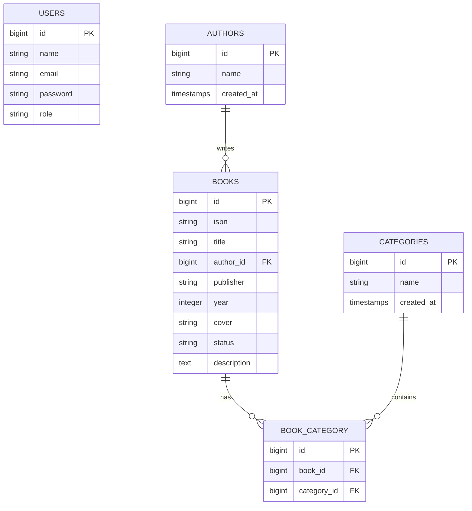
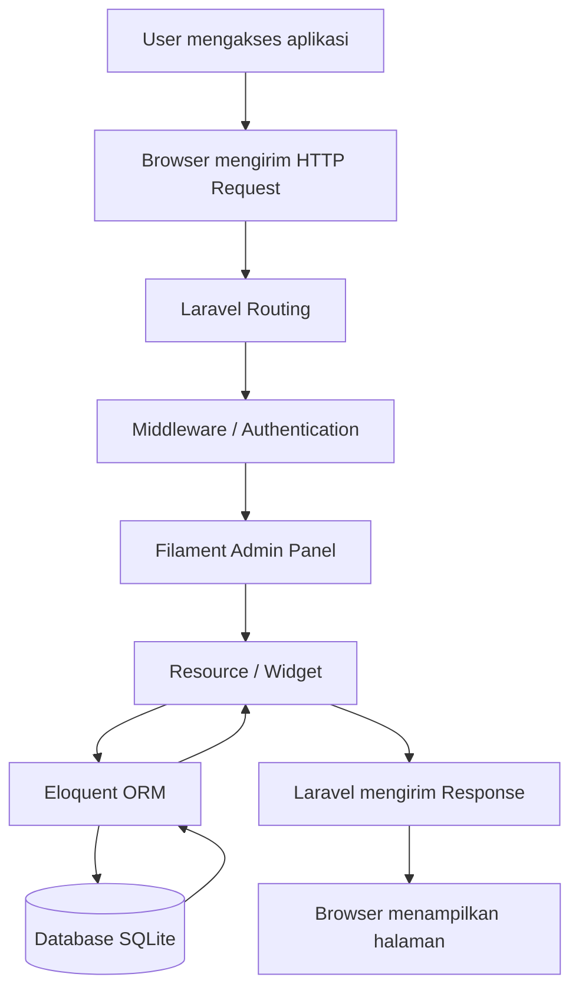
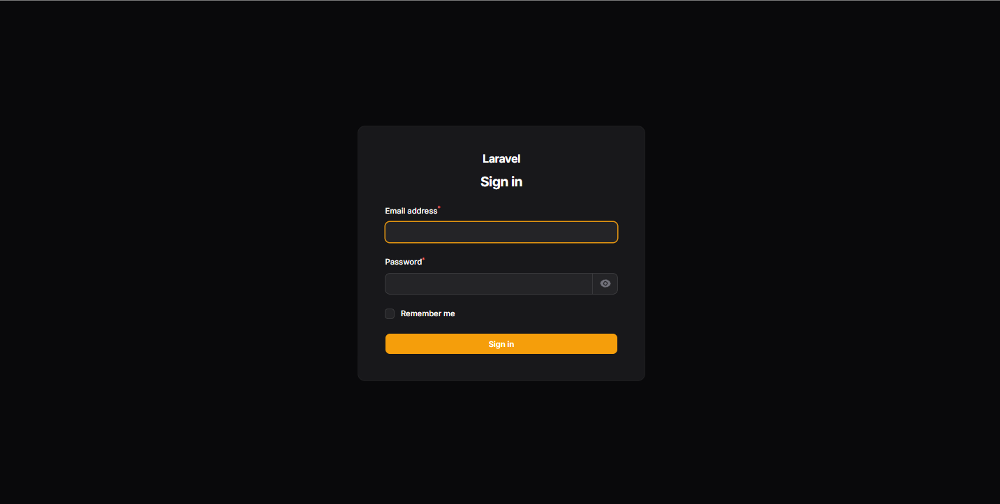
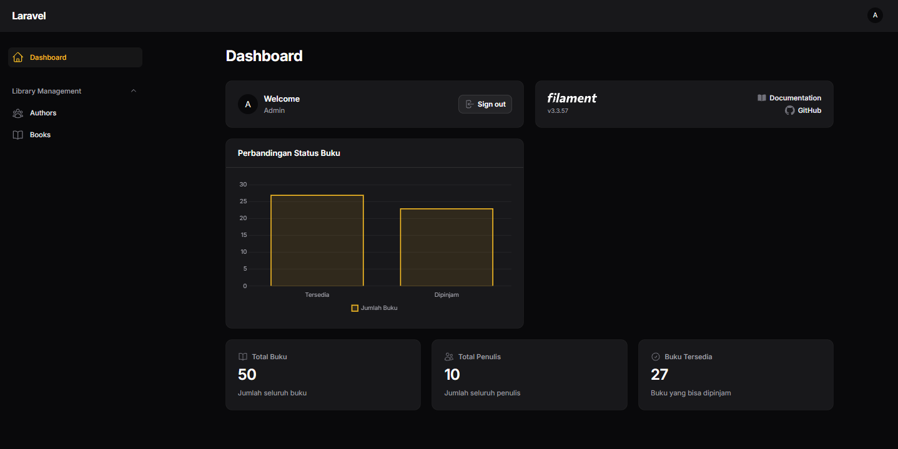
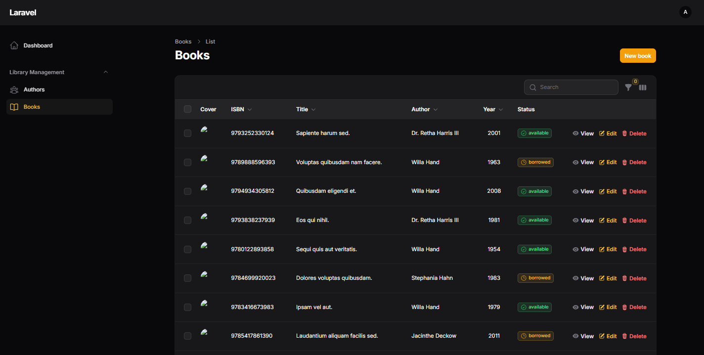
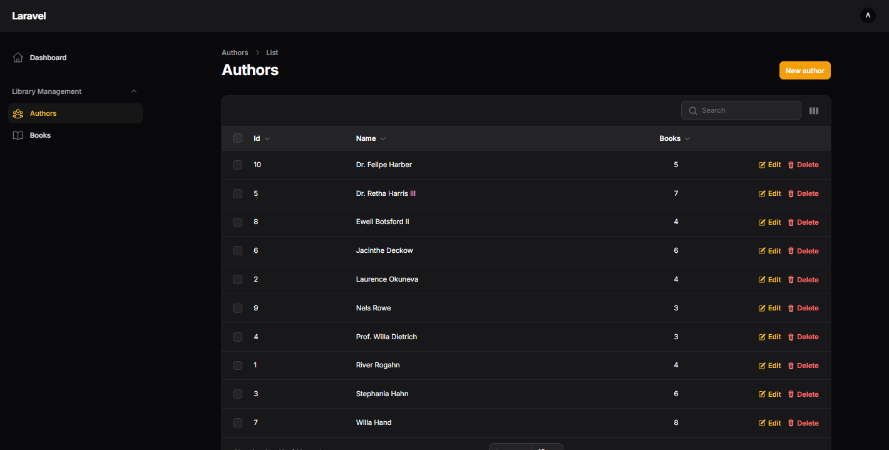
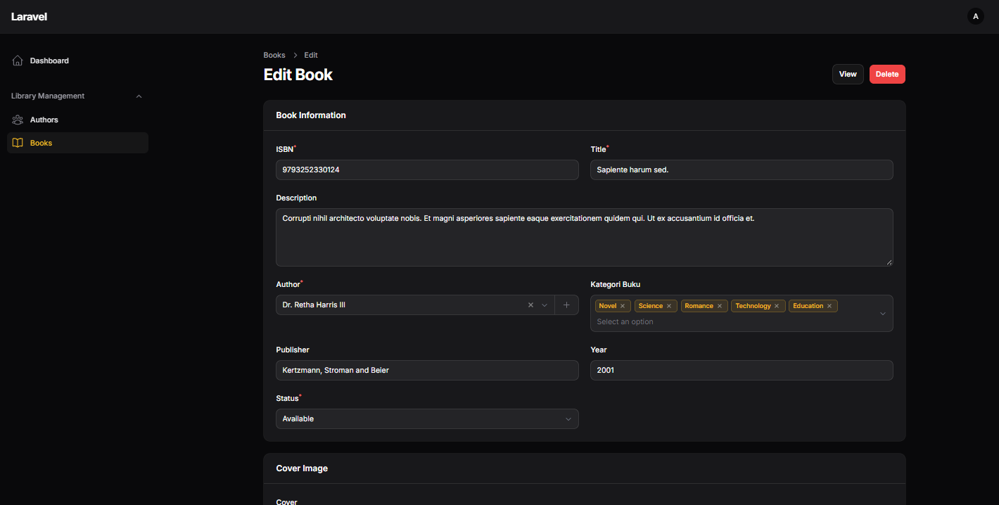
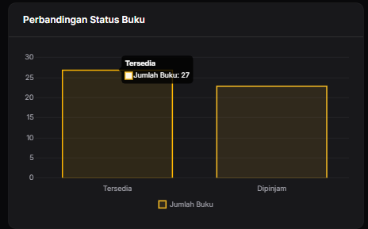

# Laporan Praktikum Laravel dan Filament

## 1. Penjelasan Arsitektur (7 Poin)

### 1.1 Deskripsi Aplikasi

Aplikasi ini merupakan sistem manajemen perpustakaan sederhana yang dikembangkan menggunakan framework Laravel dan Filament.

Aplikasi digunakan untuk mengelola data buku dan penulis, mengatur hak akses pengguna berdasarkan role, menampilkan statistik perpustakaan, serta mengelompokkan buku berdasarkan kategori.

Teknologi yang digunakan:

| Teknologi | Kegunaan |
|---|---|
| Laravel 13 | Backend framework |
| PHP 8.3 | Bahasa pemrograman |
| Filament 3 | Admin panel dan CRUD |
| SQLite | Database |
| Eloquent ORM | Pengelolaan relasi dan query database |
| Blade / Livewire | Tampilan dan interaksi aplikasi |

### 1.2 Entity Relationship Diagram (ERD)

Berikut merupakan gambaran hubungan antar tabel dalam aplikasi:

### 1.3 Penjelasan Relasi Antar Tabel

Aplikasi memiliki beberapa tabel utama, yaitu:

**1. Tabel Users**

Menyimpan informasi pengguna yang dapat mengakses admin panel. Setiap pengguna memiliki role untuk menentukan hak aksesnya.

Role yang digunakan:
- Admin: memiliki akses penuh terhadap pengelolaan data.
- Staff: dapat melihat, menambahkan, dan mengubah data buku, tetapi tidak dapat menghapusnya.
- Viewer: hanya dapat melihat data.

**2. Tabel Authors**

Menyimpan informasi penulis buku. Satu penulis dapat memiliki banyak buku.

Relasi: One to Many (1:N).

**3. Tabel Books**

Menyimpan informasi buku, seperti ISBN, judul, penulis, penerbit, tahun terbit, status, cover, dan deskripsi.

Setiap buku memiliki satu penulis melalui kolom `author_id`.

**4. Tabel Categories**

Menyimpan daftar kategori buku, seperti Novel, Romance, Technology, Education, dan Science.

**5. Tabel Book_Category**

Merupakan tabel pivot yang menghubungkan tabel Books dan Categories.

Relasi: Many to Many (N:N).

Satu buku dapat memiliki beberapa kategori dan satu kategori dapat digunakan oleh banyak buku.

### 1.4 Penjelasan Flow Aplikasi

Alur kerja aplikasi dimulai ketika pengguna mengakses aplikasi melalui browser.

Berikut alur request hingga response:

Penjelasan alur:

1. Pengguna membuka aplikasi melalui browser.
2. Browser mengirimkan HTTP Request ke aplikasi Laravel.
3. Laravel memproses request melalui routing dan middleware.
4. Middleware memeriksa autentikasi dan hak akses pengguna.
5. Filament menangani tampilan admin panel, resource, dan widget.
6. Eloquent ORM menjalankan query untuk mengambil atau mengubah data.
7. Database SQLite menyimpan dan mengembalikan data.
8. Hasil pemrosesan ditampilkan kembali kepada pengguna melalui browser.

---

## 2. Perbandingan dengan Pendekatan Tradisional (7 Poin)

### 2.1 Perbandingan CRUD Filament vs Manual

Dalam pengembangan aplikasi Laravel, CRUD (Create, Read, Update, Delete) dapat dibuat menggunakan Filament maupun secara manual.

| Aspek | Filament | Manual Laravel |
|---|---|---|
| Pembuatan CRUD | Menggunakan Resource | Membuat Controller, Route, dan View |
| Form | Menggunakan komponen form | Membuat form HTML sendiri |
| Tabel | Menggunakan Table Builder | Membuat tabel secara manual |
| Validasi | Menggunakan aturan validasi komponen | Menggunakan Laravel Validator |
| Tampilan | Komponen admin panel sudah tersedia | Desain ditentukan developer |
| Waktu pengembangan | Relatif lebih cepat | Membutuhkan lebih banyak waktu |
| Fleksibilitas | Mengikuti struktur dan kemampuan Filament | Lebih bebas dikembangkan |

### 2.2 Kelebihan dan Kekurangan Filament

**Kelebihan:**
- Mempercepat proses pembuatan CRUD.
- Menyediakan komponen form dan tabel yang siap digunakan.
- Memiliki fitur pencarian, filter, pagination, dan action.
- Menyediakan dashboard dan widget.
- Memiliki integrasi dengan Laravel Eloquent.

**Kekurangan:**
- Struktur pengembangan mengikuti pola yang disediakan Filament.
- Membutuhkan pemahaman mengenai komponen dan konfigurasi Filament.
- Kustomisasi tertentu dapat membutuhkan pemahaman lebih lanjut.
- Kurang cocok apabila membutuhkan tampilan frontend yang sangat berbeda dari admin panel.

### 2.3 Kelebihan dan Kekurangan Pendekatan Manual

**Kelebihan:**
- Memiliki kebebasan penuh dalam menentukan desain dan alur aplikasi.
- Lebih fleksibel untuk kebutuhan bisnis yang kompleks.
- Membantu developer memahami proses kerja Laravel secara lebih mendalam.

**Kekurangan:**
- Membutuhkan waktu pengembangan lebih lama.
- Harus membuat tampilan form dan tabel sendiri.
- Harus mengatur validasi, pagination, pencarian, dan fitur lainnya.
- Kode yang dibuat bisa menjadi lebih banyak.

### 2.4 Kapan Sebaiknya Menggunakan Filament dan Manual?

**Menggunakan Filament apabila:**
- Membutuhkan admin panel dalam waktu singkat.
- Mengembangkan aplikasi manajemen data.
- Membutuhkan CRUD dengan fitur standar.
- Membuat dashboard internal untuk admin atau staff.

**Menggunakan pendekatan manual apabila:**
- Membutuhkan desain frontend yang sangat khusus.
- Memiliki alur bisnis yang kompleks.
- Membutuhkan kontrol penuh terhadap tampilan dan interaksi pengguna.
- Mengembangkan aplikasi yang tidak hanya berfokus pada admin panel.

Kesimpulannya, Filament cocok digunakan untuk mempercepat pengembangan aplikasi administratif, sedangkan pendekatan manual lebih sesuai ketika fleksibilitas dan kustomisasi menjadi prioritas utama.

---

## 3. Refleksi Pembelajaran (6 Poin)

### 3.1 Apa yang Dipelajari dari Praktikum Ini?

Melalui praktikum ini, saya mendapatkan pengalaman dalam mengembangkan aplikasi menggunakan Laravel dan Filament.

Beberapa hal yang saya pelajari antara lain:

1. Memahami struktur project Laravel, termasuk Model, Migration, Seeder, dan konfigurasi aplikasi.
2. Membuat CRUD menggunakan Filament Resource.
3. Memahami penggunaan Eloquent ORM untuk mengelola data dan relasi antar tabel.
4. Menerapkan autentikasi dan pembatasan hak akses pengguna menggunakan role dan Policy.
5. Membuat dashboard menggunakan Stats Overview Widget dan Chart Widget.
6. Membuat relasi One to Many dan Many to Many pada database.
7. Mengelola perubahan database menggunakan Migration dan Seeder.
8. Menggunakan Git dan GitHub untuk menyimpan serta mengelola source code project.

### 3.2 Kesulitan yang Dihadapi dan Cara Mengatasinya

Selama mengerjakan praktikum, terdapat beberapa kendala yang saya hadapi.

**1. Kesalahan konfigurasi dan import class**

Saya sempat mengalami error ketika menggunakan model Book pada widget grafik karena class belum di-import dengan benar.

Cara mengatasinya adalah menambahkan import model yang sesuai pada bagian atas file PHP.

**2. Kesalahan pada Policy**

Saya mengalami error pada AuthorPolicy karena penggunaan tipe data Author yang mengarah ke namespace yang salah.

Cara mengatasinya adalah memperbaiki import model Author menggunakan namespace `App\Models\Author`.

**3. Pengelolaan database antar komputer**

Ketika project dipindahkan ke komputer lain melalui GitHub, struktur database dan data yang tersimpan tidak otomatis ikut berpindah.

Cara mengatasinya adalah menjalankan migration dan seeder pada komputer tujuan agar struktur tabel dan data awal dapat dibuat kembali.

**4. Kesalahan menggunakan Migration Fresh**

Saya sempat menggunakan perintah `php artisan migrate:fresh` yang menyebabkan seluruh tabel dan data dalam database terhapus.

Dari kejadian tersebut, saya memahami perbedaan antara `migrate` dan `migrate:fresh`. Untuk menjalankan migration baru tanpa menghapus data sebelumnya, saya menggunakan `php artisan migrate`.

### 3.3 Rencana Pengembangan Aplikasi Selanjutnya

Aplikasi manajemen perpustakaan ini masih dapat dikembangkan dengan beberapa fitur tambahan, antara lain:

1. **Sistem Peminjaman Buku:** Menambahkan fitur peminjaman dan pengembalian buku.
2. **Manajemen Stok:** Mengelola jumlah buku yang tersedia dan sedang dipinjam.
3. **Riwayat Peminjaman:** Menampilkan riwayat transaksi peminjaman setiap pengguna.
4. **Pencarian dan Filter:** Menambahkan pencarian berdasarkan judul, penulis, dan kategori.
5. **Laporan Perpustakaan:** Menambahkan fitur export laporan ke PDF atau Excel.
6. **Pengembangan Tampilan:** Membuat halaman frontend yang dapat digunakan oleh pengunjung perpustakaan tanpa harus masuk ke admin panel.

---

## 4. Kesimpulan

Berdasarkan praktikum yang telah dilakukan, Laravel dan Filament dapat digunakan untuk membangun aplikasi manajemen data dengan lebih cepat dan terstruktur.

Filament membantu proses pembuatan CRUD, pengelolaan data, serta dashboard tanpa harus membangun seluruh komponen dari awal.

Selain mempelajari penggunaan framework, praktikum ini juga memberikan pemahaman mengenai relasi database, autentikasi, authorization, migration, seeder, dan pengelolaan source code menggunakan GitHub.

Dengan demikian, aplikasi yang telah dibuat dapat menjadi dasar untuk pengembangan sistem manajemen perpustakaan yang lebih lengkap.

---

## 5. Dokumentasi Aplikasi

Tambahkan screenshot hasil praktikum pada bagian ini sebagai bukti implementasi.

| No. | Dokumentasi | Screenshot |
|---|---|---|
| 1 | Halaman Login |  |
| 2 | Dashboard Statistik |  |
| 3 | Data Buku |  |
| 4 | Data Penulis |  |
| 5 | Form Buku dan Kategori |  |
| 6 | Grafik Status Buku |  |

---

**Dikembangkan menggunakan Laravel dan Filament.**  